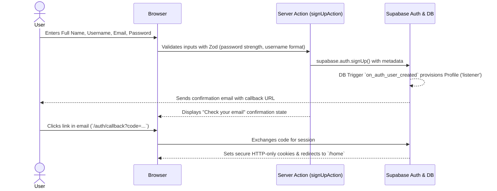
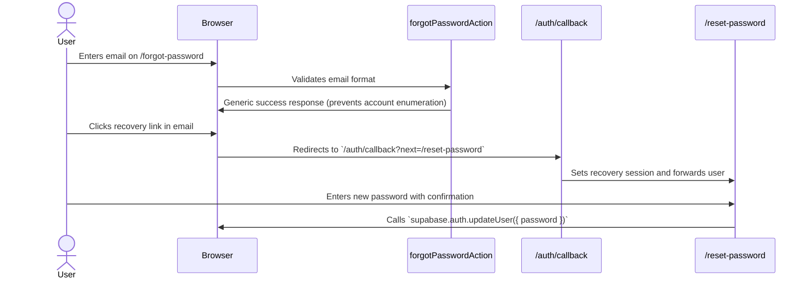

# SONORA — Authentication & User Management Guide

## 1. Authentication Architecture

SONORA uses **Supabase Auth** integrated with the **Next.js 16 App Router** using official server-side rendering (`@supabase/ssr`) and PostgreSQL security triggers.

### Architectural Highlights:
1. **Server-Side Session Verification**: Sessions are validated securely on the server via `supabase.auth.getUser()`. Client-side tokens or localStorage are never trusted as the sole source of authorization truth.
2. **Deterministic Profile Provisioning**: The `on_auth_user_created` trigger in PostgreSQL migration 05 automatically creates an application profile in `public.profiles` upon `auth.users` insertion, defaulting the role strictly to `'listener'`.
3. **Privilege Escalation Immune**: Users cannot supply or modify their own role during signup or profile updates. Database triggers (`guard_profiles_role_escalation`) reject client self-promotion attempts.
4. **Next.js Proxy Session Synchronization**: The root `src/proxy.ts` handler refreshes auth tokens and synchronizes session cookies on every non-static request.
5. **Open Redirect Defense**: All redirect URLs (such as `redirectTo` or `next` callback parameters) are strictly validated to ensure they are safe internal paths, preventing open redirect exploits.

---

## 2. Authentication Flows

### A. User Registration & Email Verification


### B. Password Recovery & Reset Flow


---

## 3. Routes & Endpoints Reference

| Route | Type | Access Level | Description |
|:---|:---|:---:|:---|
| `/signup` | Page | Public | User registration with real-time username check and password strength meter. |
| `/login` | Page | Public | Email and password sign in with safe internal redirect handling. |
| `/forgot-password` | Page | Public | Recovery request form. Prevents email enumeration. |
| `/reset-password` | Page | Recovery Session | Allows updating password when authenticated via a recovery session link. |
| `/auth/callback` | Route Handler (GET) | Public | Exchanges PKCE verification codes for sessions and redirects safely. |
| `/profile` | Page | Authenticated | User profile management, avatar uploads to `artwork` bucket, and account information. |
| `/library` | Page | Authenticated | Personal user library (liked songs, playlists, followed artists). |

---

## 4. Server-Side Authorization Helpers

Located in `src/lib/auth/authorization.ts`:

- `getCurrentUser()`: Fetches the authenticated `User` from the server-side Supabase client.
- `requireAuthenticatedUser(redirectTo?: string)`: Requires a logged-in user or safely redirects to `/login?redirectTo=...`.
- `getCurrentProfile()`: Fetches the caller's row from `public.profiles`.
- `requireRole(allowedRoles: UserRole[])`: Ensures the caller holds one of the specified roles (`listener`, `artist`, `moderator`, `admin`).
- `isAdmin()`: Returns boolean indicating whether the user is an administrator.
- `isModerator()`: Returns boolean indicating whether the user is a moderator or admin.
- `isArtist()`: Returns boolean indicating whether the user is an artist, moderator, or admin.

---

## 5. Supabase Dashboard Configuration Checklist

When linking to a hosted Supabase project, configure the following settings in your Supabase Dashboard:

### 1. URL Configuration (`Authentication` -> `URL Configuration`)
- **Site URL**: `https://your-domain.com` (or `http://localhost:3000` for development).
- **Redirect URLs**:
  - `http://localhost:3000/auth/callback`
  - `https://your-domain.com/auth/callback`
  - `https://your-domain.com/reset-password`

### 2. Email Provider Settings (`Authentication` -> `Providers` -> `Email`)
- **Enable Email Provider**: `ON`
- **Confirm Email**: `ON` (recommended for production).
- **Secure Email Change**: `ON` (sends confirmation to both old and new addresses).

### 3. Storage Buckets (`Storage`)
- Verify that `artwork` bucket exists with public read access (configured in migration 04).
- User avatar uploads are partitioned under `artwork/{user_id}/avatar-[timestamp].[ext]`.

---

## 6. Local Testing Instructions

### Testing Registration & Login
1. Start development server:
   ```bash
   pnpm dev
   ```
2. Navigate to `http://localhost:3000/signup`.
3. Fill out the registration form. Notice the real-time username availability indicator and dynamic password strength meter.
4. If running with a local Supabase instance (`npx supabase start`), open Inbucket email inbox at `http://localhost:54324` to click the confirmation link.
5. Sign in at `http://localhost:3000/login`.
6. Navigate to `http://localhost:3000/profile` to test updating display name, bio, and uploading a profile picture.
7. Click the user avatar in the top right header to open the dropdown menu and select "Sign Out".
