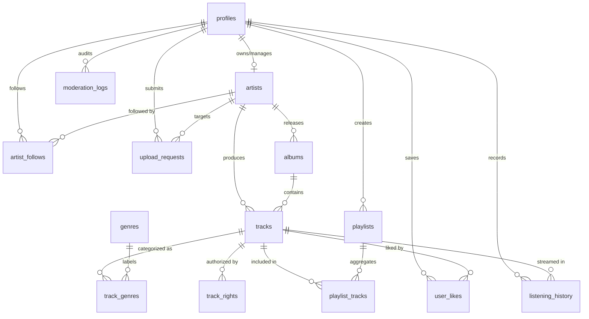

# SONORA — Database Architecture & Data Model

## 1. Architectural Philosophy

SONORA's database foundation is built as a **secure, relational modular monolith** powered by PostgreSQL and Supabase. The schema is designed from day one with consumer music streaming scale, independent artist empowerment, and enterprise rights verification in mind.

### Core Architecture Principles:
1. **Relational Integrity First**: Every track, album, artist, playlist, and rights agreement is bound by strict foreign keys, check constraints, and unique indices.
2. **Immutable Rights Assurance**: A track is never treated as public simply because audio was uploaded. It cannot become publicly discoverable or streamable without an approved, verified rights record.
3. **Defense in Depth**: Security is not left to application code. PostgreSQL Row Level Security (RLS) policies and security definer triggers strictly enforce role isolation and prevent privilege escalation at the database tier.
4. **Non-Destructive Deletions**: Track rights, moderation logs, and verified catalog assets use `ON DELETE RESTRICT` or soft deletion to prevent legal disputes or audit trail destruction.

---

## 2. Entity-Relationship Overview

---

## 3. Domain Clusters

### Cluster A: User Identity & Profiles
- **`profiles`**: Linked 1:1 with `auth.users(id)`. Houses application usernames, display names, avatars, bios, and system roles (`listener`, `artist`, `moderator`, `admin`).
- Role escalation is actively blocked by the `guard_profiles_role_escalation` database trigger.

### Cluster B: Artist & Discography
- **`artists`**: Verified artist identities with biographies, country/region metadata, genres, and ownership mapping to user profiles.
- **`albums`**: Editorial releases (`album`, `EP`, `single`, `compilation`) with release dates, artwork, and publication status (`draft`, `published`, `archived`).
- **`tracks`**: Master audio asset records with duration, audio paths, language, explicit flags, and publication status.
- **`genres` & `track_genres`**: Normalized M:N genre classifications.

### Cluster C: Rights Verification & Legal Assurance
- **`track_rights`**: Dedicated compliance table logging rights holders, licensing agreements, attribution requirements, commercial permissions, and evidence attachments.
- **Verification Gate**: Tracks are only visible to the public if `status = 'published'` and a verified rights record exists with `streaming_allowed = true`.
- **Self-Approval Prevention**: The `guard_track_rights_approval` trigger rejects any attempt by an artist to approve their own track rights.

### Cluster D: User Library & Curation
- **`playlists` & `playlist_tracks`**: User and editorial playlists with position-indexed track ordering and duplicate prevention.
- **`user_likes`**: Private bookmarks for listener music libraries.
- **`artist_follows`**: Artist following relationships.
- **`listening_history`**: Strict user-private playback history logs for listening habits and analytics.

### Cluster E: Uploads & Content Moderation
- **`upload_requests`**: Submissions lifecycle (`submitted`, `under_review`, `approved`, `rejected`, `changes_requested`).
- **`moderation_logs`**: Immutable audit logs of all administrative decisions with before/after state captures.
