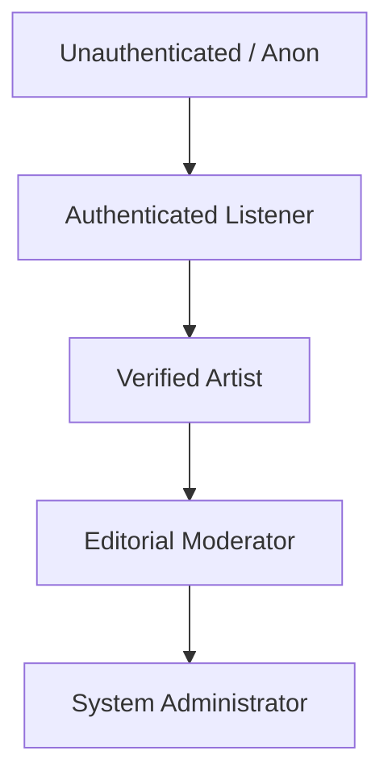

# SONORA — Row Level Security (RLS) & Authorization Engine

## 1. Security Overview

SONORA enforces a **Zero-Trust Database Security Model**. Row Level Security (RLS) is enabled on **all 14 application tables**. Every SQL statement executed through the Supabase PostgREST API is evaluated against explicit security policies defined for the caller's JWT identity (`auth.uid()`) and role.

---

## 2. Role Hierarchy

| Role | Catalog Read | Manage Own Profile | Playlists / Likes / History | Upload Submissions | Verify Rights / Moderate | Manage System / Roles |
|:---|:---:|:---:|:---:|:---:|:---:|:---:|
| **Anon** | Public Verified Only | ✗ | ✗ | ✗ | ✗ | ✗ |
| **Listener** | Public Verified Only | Yes (non-role fields) | Full Control (Own) | ✗ | ✗ | ✗ |
| **Artist** | Public + Own Drafts | Yes | Full Control (Own) | Yes (Own Artist) | ✗ (Guard Blocked) | ✗ |
| **Moderator** | Full Read | Yes | Full Control (Own) | Review Submissions | Yes | ✗ |
| **Admin** | Full Read | Yes | Full Control (Own) | Full Control | Full Control | Yes |

---

## 3. Database Security Triggers

### 1. `guard_profiles_role_escalation`
Prevents unauthorized privilege escalation.
- **Trigger**: `BEFORE UPDATE ON public.profiles`
- **Rule**: If `NEW.role != OLD.role`, execution is terminated with an exception unless the caller is `auth.role() = 'service_role'` or an administrator (`is_admin() = true`).
- **Impact**: Regular users cannot promote themselves or other accounts to `artist`, `moderator`, or `admin`.

### 2. `guard_track_rights_approval`
Prevents conflicts of interest in rights authorization.
- **Trigger**: `BEFORE INSERT OR UPDATE ON public.track_rights`
- **Rule**: When `verification_status` is updated to `'verified'`:
  1. Caller must be an authorized moderator or administrator (`is_moderator()`).
  2. If the caller owns the artist profile associated with the track (`owner_user_id = auth.uid()`), the update is **rejected with a security exception**.
- **Impact**: Artists are mathematically prevented from approving their own licensing documents.

---

## 4. Authorization Helper Functions

All helper functions are declared as `SECURITY DEFINER` with fixed `search_path = public` to prevent search-path injection vulnerabilities.

- **`current_user_role()`**: Returns the caller's role from `public.profiles`.
- **`is_admin()`**: Returns `true` if caller has `role = 'admin'`.
- **`is_moderator()`**: Returns `true` if caller has `role IN ('moderator', 'admin')`.
- **`is_artist()`**: Returns `true` if caller has `role IN ('artist', 'moderator', 'admin')`.
- **`owns_artist(p_artist_id UUID)`**: Checks whether `owner_user_id = auth.uid()`.
- **`track_has_verified_streaming_rights(p_track_id UUID)`**: Verifies whether an active rights record with `streaming_allowed = true` and `verification_status = 'verified'` exists.
- **`is_track_publicly_visible(p_track_id UUID)`**: Combined gate requiring `status = 'published'` and verified streaming rights.

---

## 5. Table-by-Table Policy Summary

| Table | SELECT | INSERT | UPDATE | DELETE |
|:---|:---|:---|:---|:---|
| `profiles` | Active profiles public; private for self | Self or Admin | Self (non-role fields) | Admin only |
| `artists` | Verified public; own draft visible to owner | Owner or Admin | Owner or Moderator | Admin only |
| `genres` | Public read all | Admin only | Admin only | Admin only |
| `albums` | Published public; drafts to owner | Artist owner | Artist owner or Moderator | Admin only |
| `tracks` | Published + Verified rights public; drafts to owner | Artist owner | Artist owner or Moderator | Admin only |
| `track_genres` | Public if track visible | Artist owner or Admin | ✗ | Artist owner or Admin |
| `track_rights` | Owner or Moderator only (Private) | Artist owner (declaration) | Moderator only | Admin only |
| `playlists` | Public if `is_public = true`; private to owner | Owner | Owner | Owner |
| `playlist_tracks` | Inherited from playlist visibility | Playlist owner | Playlist owner | Playlist owner |
| `user_likes` | Strict Owner only (`user_id = auth.uid()`) | Owner | ✗ | Owner |
| `listening_history` | Strict Owner only (`user_id = auth.uid()`) | Owner | Owner | Owner |
| `artist_follows` | Strict Owner only | Owner | ✗ | Owner |
| `upload_requests` | Submitting artist or Moderator | Submitting artist | Moderator or Submitter | Admin only |
| `moderation_logs` | Moderator or Admin only | Moderator only | ✗ (Immutable) | ✗ (Immutable) |
