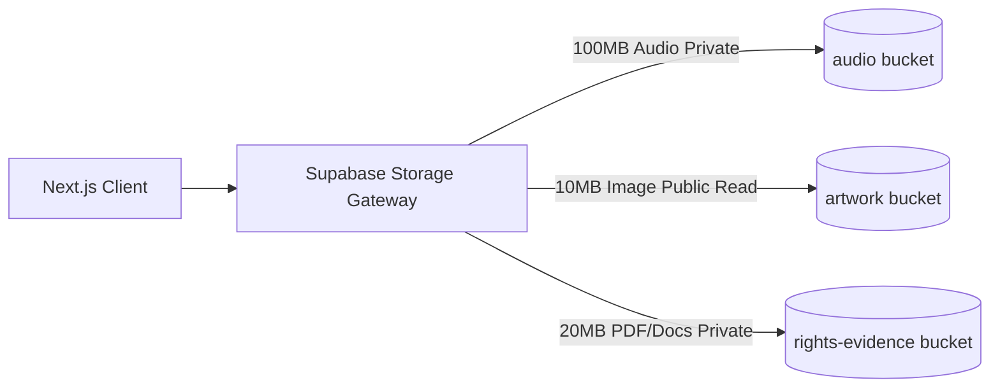

# SONORA — Storage Architecture & Bucket Security

## 1. Bucket Overview

SONORA partitions all file storage into three dedicated Supabase Storage buckets, enforcing least-privilege access and strict size/MIME type validation at the storage gateway.

---

## 2. Bucket Configurations

### 1. `audio`
- **Access Tier**: `private` (`public = false`)
- **File Size Limit**: `104,857,600 bytes` (100 MB)
- **Allowed MIME Types**: `audio/mpeg`, `audio/wav`, `audio/flac`, `audio/ogg`, `audio/aac`, `audio/mp4`
- **Folder Partitioning**: `audio/{user_id}/{track_id}.[ext]`
- **Security Policy**:
  - `SELECT`: Only track owners (`(storage.foldername(name))[1] = auth.uid()`), moderators, or service role.
  - Public listeners **never receive direct public URLs**. In Phase 5, playback will issue time-limited (e.g. 60-second) signed URLs via authenticated server-side endpoints.
  - `INSERT`: Verified artists and administrators.
  - `UPDATE` / `DELETE`: File owner (prior to publication) or administrator.

### 2. `artwork`
- **Access Tier**: `public read` (`public = true`)
- **File Size Limit**: `10,485,760 bytes` (10 MB)
- **Allowed MIME Types**: `image/jpeg`, `image/png`, `image/webp`, `image/avif`
- **Folder Partitioning**:
  - `artwork/artists/{artist_id}/avatar.[ext]`
  - `artwork/artists/{artist_id}/cover.[ext]`
  - `artwork/albums/{album_id}/cover.[ext]`
  - `artwork/playlists/{playlist_id}/cover.[ext]`
- **Security Policy**:
  - `SELECT`: Public access (enables CDN caching and Next.js `<Image />` optimization).
  - `INSERT`: Authenticated users uploading assets under their user folder `artwork/{user_id}/*`.
  - `UPDATE` / `DELETE`: Asset owner or administrator.

### 3. `rights-evidence`
- **Access Tier**: `strictly private` (`public = false`)
- **File Size Limit**: `20,971,520 bytes` (20 MB)
- **Allowed MIME Types**: `application/pdf`, `image/jpeg`, `image/png`, `text/plain`
- **Folder Partitioning**: `rights-evidence/{user_id}/{evidence_id}.[ext]`
- **Security Policy**:
  - `SELECT`: Confidential to the submitting artist, editorial moderators, and administrators.
  - `INSERT`: Artists uploading contracts, licensing agreements, or permission affidavits.
  - `UPDATE` / `DELETE`: Administrator only (preserves evidentiary integrity).
